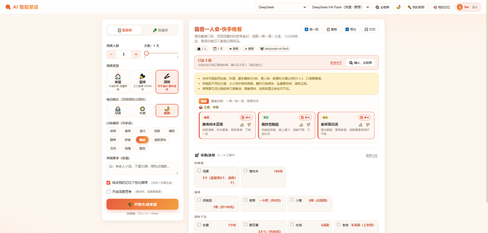
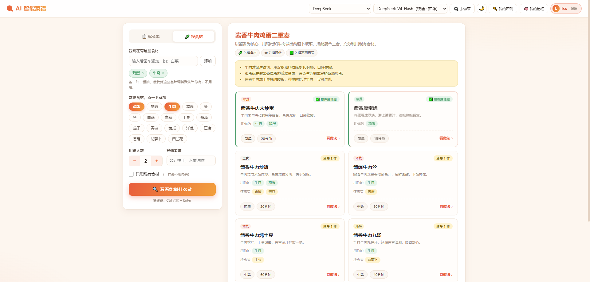
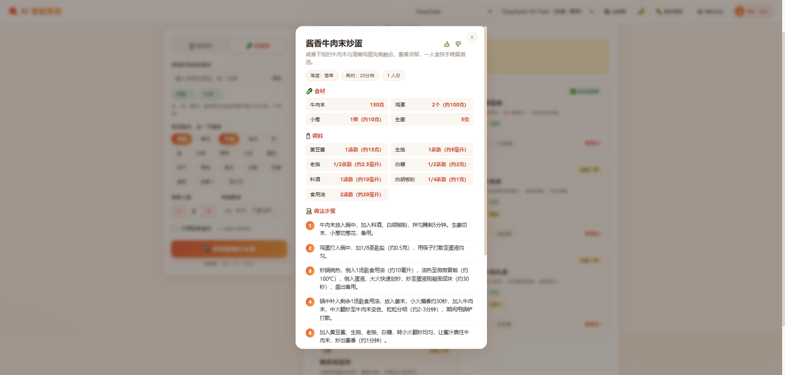

# 🍳 AI 智能菜谱

基于国产大模型（DeepSeek / 通义千问 Qwen）的智能定制菜谱应用。零前端框架、零数据库，`node server.js` 就能跑。

## 功能

**菜单生成**

- **按人数定制**：1–30 人步进调节，采购量自动按人数换算
- **口味偏好**：麻辣、清淡、咸鲜等 12 种口味多选
- **用餐类型**：宴席 🎉 / 家宴 🏠 / 简餐 🥢 三种场景，AI 按场景调整菜品数量与排场
- **1–7 天菜单**：滑杆自由调节天数
- **餐次自由勾选**：早 / 中 / 晚三个独立按钮，想做哪餐点哪餐——只做晚餐、只要早+晚都行，不是固定组合
- **每日餐次卡片**：主食 + 凉菜/荤菜/素菜/汤品/蒸菜/甜点 分类展示，附一句话风味介绍
- **菜品详情**：点击任意菜品，AI 生成完整做法——食材用量（按人数换算）、调料、分步骤火候要点、小贴士与营养提示

**🥬 按食材找菜**

冰箱里剩点东西，不想从头排菜单时用这个——和「配菜单」互为补充：那个从需求出发，这个从库存出发。

- 食材可手输（一次粘一串会自动拆开）或点常见食材快捷添加，自动去重
- 每道菜标出**用了你的哪几样** + **还缺什么**，「不用再买」的排最前面
- 盐、油、酱油、葱姜蒜等基础调料默认视为齐全，不算缺料
- **「只用现有食材」开关**：勾上后只留一样都不用再买的菜
- 结果里会提示**哪些食材没派上用场**，剩的还得想办法

**个性化记忆**

- 记住昵称、常用人数、喜欢/不喜欢的口味、忌口过敏食材
- 给菜品点 👍/👎 自动沉淀偏好，后续生成时「喜欢的多做类似、不喜欢的不再出现」
- **✅ 选菜才算数**：生成只是「看过」，在结果里勾选你这次真正要做的菜、点「确认我做了这些」，才写入「最近做过」。后续生成据此避重——不会因为生成过一份七天菜单，就把几十道你压根没做的菜全避开
- 关掉「结合我的记忆」＝无痕生成，不写入历史与偏好

**🍳 做菜界面**

- 勾完菜点「确认，去做菜」，先选**第 1 天对应的真实日期**（今天 / 明天 / 后天快捷键，或自己挑），之后每天自动往后顺排
- 顶部**只显示日期**（2026年8月26日 星期三 · 今天），左右箭头翻看其他日期，「回到今天」一键归位
- 今天要做的菜按餐次列出，**点菜名展开完整做法**；每道可勾「做完了」，进度条实时显示 `3/5 道已完成`
- **🧺 今日食材汇总**：把今天这几道菜的食材合并，同单位自动相加（`300 g + 200 g → 500 g`），做之前一次备齐
- 顶栏「🍳 去做菜」随时切回，进度与日期刷新不丢

**菜单管理**

- **🛒 采购清单**：按蔬菜 / 肉禽蛋 / 水产 / 米面豆制品 / 调料干货分组，可勾选打钩，进度本地保存
- **🕐 历史回看**：最近 20 次生成保留完整菜单快照，点一下即可原样恢复（连当时勾了哪几道菜一起还原）；支持单条删除与一键清空
- **导出**：一键复制纯文本、导出 Markdown、打印（或另存为 PDF，打印会输出全部天数）
- **换一批**：用同样的条件让 AI 再配一桌

**账号与模型**

- 用户名 + 密码注册登录，数据按用户隔离（scrypt 加盐哈希，30 天会话，支持改密）
- 每个用户可填自己的 API Key，服务端保存、对外只回打码值
- 顶栏随时切换 DeepSeek-V4-Flash / V4-Pro 或 Qwen3.7-Plus / 3.7-Flash / 3.8-Max
- **🧠 深度思考开关**：两家新模型都支持思考模式，默认关闭（配菜任务用不上链式推理，开了只更慢更贵），需要更讲究的搭配时再打开
- 🌙 深色模式（跟随系统 / 浅色 / 深色三态切换）、移动端适配、`Ctrl/⌘ + Enter` 快捷生成

## 界面预览

### 配菜单：按人数、口味、场景生成

左边设条件，右边出菜单。餐次是**早/中/晚三个独立按钮**，想做哪餐点哪餐，不是固定套餐。
生成后勾选这次真正要做的菜，确认了才写进「最近做过」——**生成不等于做过**。



### 按食材：冰箱里有什么就做什么

从库存出发，和上面正好互补。每道菜标出**用了你的哪几样**、**还缺什么**，
「现在就能做」的排最前面；勾上「只用现有食材」就只留一样都不用买的。



### 菜品详情：点开就能照着做

用量按人数换算到克/毫升，步骤带火候、时间和判断标准（「油热至微微冒烟（约180℃）」
「炒至蛋液刚凝固成块（约30秒）」），不是「适量」「少许」糊弄过去。



## 快速开始

```bash
npm install
```

```bash
node server.js
```

打开 <http://localhost:3000>，注册一个账号即可开始。

**接入真实大模型**（二选一即可）：

- 方式 A（推荐，多人使用）：登录后点右上角 **🔑 我的密钥**，填入自己的 Key，只对当前账号生效。
- 方式 B（单人自用）：复制 `.env.example` 为 `.env`，填入全局 Key。

```bash
DEEPSEEK_API_KEY=sk-xxxx      # https://platform.deepseek.com
QWEN_API_KEY=sk-xxxx          # https://bailian.console.aliyun.com
```

> 未配置任何 Key 且 `MOCK_MODE=1` 时，界面显示「演示模式」，用内置示例数据完整体验所有功能（菜单结构、采购清单、详情做法与真实生成完全一致）。

### 环境变量

| 变量 | 默认值 | 说明 |
| --- | --- | --- |
| `PORT` | `3000` | 服务端口 |
| `DEEPSEEK_API_KEY` | 空 | 全局 DeepSeek Key，用户未配置自己的 Key 时兜底 |
| `QWEN_API_KEY` | 空 | 全局通义千问 Key |
| `DEFAULT_PROVIDER` | `deepseek` | 默认服务商（`deepseek` \| `qwen`） |
| `MOCK_MODE` | `1` | 为 `1` 且无任何可用 Key 时启用演示数据 |
| `AI_RECIPE_DB` | `src/data/db.json` | 数据文件位置，可指向别处（测试 / 多实例隔离） |

## 测试

```bash
npm test
```

零依赖自测，覆盖 JSON 容错解析、菜谱与详情归一化、演示数据、存储层（账号 / Key 打码 / 反馈 / 历史）以及全部 HTTP 接口。测试跑在系统临时目录的独立数据文件上，不会碰你的真实数据。

## 别把密钥提交上去

`.env` 和 `src/data/db.json`（存着账号与各用户的 API Key）已在 `.gitignore` 里，但 `.gitignore` 只挡误操作，挡不住 `git add -f`。

所以装了一个提交前钩子，扫的是**暂存区内容**：

```bash
npm run check-secrets    # 手动扫全部历史，推之前自查
```

命中 `sk-` / `ghp_` / `LTAI` 等密钥特征，或试图提交 `.env`、`db.json` 时直接拒绝提交；文档里 `sk-xxxx` 这类示例会跳过，不误报。

钩子在 `.git/hooks/pre-commit`（不随仓库分发），重新 clone 后需要再装一次：

```bash
printf '#!/bin/sh
exec node "$(git rev-parse --show-toplevel)/scripts/check-secrets.js"
' > .git/hooks/pre-commit
chmod +x .git/hooks/pre-commit
```

> ⚠️ 扫描器一律用 `execFileSync` + 参数数组调 git，不拼 shell 字符串。Windows 下拼字符串会因转义问题让 git 静默失败，结果被当成「没扫到」，给出**假的通过**——那比不扫更危险。所以它在 git 出错时会 exit 2 明确报错，绝不伪装成通过。

## 项目结构

```
ai-recipe/
├── server.js              # Express 入口（静态资源 + API 挂载 + 错误处理）
├── public/
│   ├── index.html         # 单页界面
│   ├── style.css          # 样式（含深色模式与打印样式）
│   └── app.js             # 前端交互逻辑
├── src/
│   ├── config.js          # 模型服务商配置（DeepSeek / Qwen）
│   ├── auth.js            # Bearer Token 鉴权中间件
│   ├── llm/client.js      # OpenAI 兼容聊天调用 + JSON 提取与自愈重试
│   ├── routes/api.js      # REST 接口
│   ├── services/
│   │   ├── recipe.js      # 菜谱生成（提示词工程 + 结果归一化 + 演示数据）
│   │   ├── pantry.js      # 按食材找菜（用了什么 / 还缺什么）
│   │   └── detail.js      # 菜品详情生成与归一化
│   └── store/db.js        # 本地 JSON 存储（账号 / Key / 记忆 / 历史）
├── scripts/
│   ├── test.js            # 零依赖自测
│   ├── check-secrets.js   # 提交前密钥扫描
│   └── untar.js           # 无依赖 .tgz 解包工具（离线装包时用）
└── .env                   # Key 与端口配置
```

## API 一览

除 `/api/health` 与 `/api/auth/{register,login,logout}` 外，所有接口都需要 `Authorization: Bearer <token>`。

| 方法 | 路径 | 说明 |
| --- | --- | --- |
| GET | `/api/health` | 存活检查（版本、运行时长、演示模式） |
| POST | `/api/auth/register` | 注册，返回 `{ token, user }` |
| POST | `/api/auth/login` | 登录（同一用户名 10 分钟内最多 8 次失败） |
| POST | `/api/auth/logout` | 登出，销毁当前会话 |
| GET | `/api/auth/me` | 会话恢复，返回当前用户 |
| POST | `/api/auth/password` | 修改密码，成功后所有旧会话失效 |
| GET | `/api/keys` | 当前用户的 Key 状态（打码） |
| POST | `/api/keys` | 保存/清除某服务商的 Key（传空串＝清除） |
| GET | `/api/config` | 服务商与模型列表、口味选项、演示模式状态 |
| POST | `/api/recipes/generate` | 生成菜谱（`people` / `days` / `tastes` / `mealType` / `meals` / `extra` / `useMemory` / `thinking`） |
| POST | `/api/recipes/by-ingredients` | 按现有食材推荐能做的菜（`ingredients` / `people` / `strict` / `tastes` / `extra`） |
| POST | `/api/recipes/detail` | 生成单道菜的详细做法（同样接受 `thinking`） |
| GET / POST | `/api/memory` | 读取 / 更新个人口味记忆 |
| POST | `/api/feedback` | 菜品 👍/👎 口味反馈（`like` / `dislike` / `unlike` / `undislike`） |
| POST | `/api/cook` | 确认本次做了哪些菜（`dishes` / `picks` / `historyId` / `startDate`），写入「最近做过」 |
| GET | `/api/history` | 历史列表（摘要，不含完整菜单） |
| GET | `/api/history/:id` | 回看某次生成的完整菜单 |
| DELETE | `/api/history/:id` | 删除单条历史 |
| DELETE | `/api/history` | 清空全部历史 |

## 支持的模型

两家都走 OpenAI 兼容的 `/chat/completions`，切换只改 `model` 参数。

| 服务商 | 模型 ID | 定位 | 上下文 |
| --- | --- | --- | --- |
| DeepSeek | `deepseek-v4-flash` | 快速便宜，默认 | 1M |
| DeepSeek | `deepseek-v4-pro` | 最强 | 1M |
| Qwen | `qwen3.7-plus` | 均衡，默认 | 1M |
| Qwen | `qwen3.7-flash` | 快速省钱 | 1M |
| Qwen | `qwen3.8-max` | 旗舰 | 1M |

**深度思考**由请求参数控制，不再是单独的模型名：DeepSeek 用 `thinking: { type: "enabled" | "disabled" }`，Qwen 用 `enable_thinking: true | false`。百炼默认开启思考，所以关闭时也会显式把 `false` 发出去，避免每次生成都白白多花钱。

**旧模型自动迁移**：`deepseek-chat` / `deepseek-reasoner` 已于 2026-07-24 彻底下线，`qwen-max` / `qwen-plus` / `qwen-turbo` 也已换代。浏览器里存的旧选择会在服务端静默映射到现役模型（见 `src/config.js` 的 `LEGACY_MODELS`），不会因为下线的模型名直接报错。

## 两个容易做错的产品细节

**餐次不是固定套餐。** `meals` 是有序槽位数组 `['breakfast','lunch','dinner']` 的任意子集，至少一项。旧版的 `mealsPerDay: 'all' | 'lunch-dinner'` 仍被接受并自动转换，老的历史记录不会读崩。

**「生成过」不等于「做过」。** 这两件事写在不同地方：

| 动作 | 写入 | 影响 |
| --- | --- | --- |
| 生成菜单 | `history`（含菜单快照） | 只是留档，可回看 |
| 勾选 + 确认做了 | `recentDishes` + 该条历史的 `cooked` | 后续生成避免重复推荐 |
| 👍 / 👎 | `likedDishes` / `dislikedDishes` | 口味倾向，与做没做无关 |

`recentDishes` 只增不减（做过就是做过），要撤销请在「🧠 我的记忆」里单独移除某一项。

**勾选必须按天归属。** 同一道菜可能出现在第 1 天和第 3 天，如果勾选只存菜名，勾了第 1 天会让第 3 天也跟着亮。所以前端存的是 `第几天::菜名`（`picks`），做菜界面据此按天过滤、完成进度也按天独立；提交给记忆的才是去重后的菜名（`dishes`）。历史回看优先用 `picks` 精确还原，老记录没有这个字段就退回本地草稿。

**模型报的「用了你的食材」不能全信。** 它很爱把用户没提过的东西写进 `uses`（比如把「葱花」算成你的食材）。所以 `normalizeDish` 只保留能和用户原始输入对上的项（支持「白菜」对上「大白菜」这类包含关系），对不上的一律挪进 `missing`——「用了你的哪几样」必须是可信的，否则这个功能就没意义了。

## 前端资源版本

首页由服务端渲染，`Cache-Control: no-store`，并把 `app.js` / `style.css` 的引用改写成带指纹的 `?v=<hash>`（指纹取自两个文件的修改时间与大小）。

这解决的是一类很难排查的故障：**HTML 更新了、JS 还是浏览器缓存里的旧版**。旧 JS 引用新 HTML 里已经不存在的元素会抛错，初始化中断，登录表单退化成原生 GET，页面被刷成 `/?` —— 看起来就是「登不上」。现在资源 URL 随内容变化，不可能错配。

另外两道保险：登录相关的事件绑定在 `boot()` 里最先执行，不受后续初始化报错影响；登录表单带 `onsubmit="return false"`，哪怕 JS 完全没跑起来也不会跳转。

## 可靠性设计

大模型返回的 JSON 并不总是规规矩矩，服务端做了三层兜底：

1. **提取**：容忍 ```` ```json ```` 代码块、前后解释文字、结尾多余内容；再不行就按括号配平扫描出第一段合法 JSON。
2. **自愈**：解析仍失败时，自动追加一轮「只输出合法 JSON」的修复请求。
3. **归一化**：把结果收敛成前端能安全渲染的结构——补全缺失字段、丢弃无名菜品与空餐次、重排天数、兼容菜品写成纯字符串等写法。前端拿到的永远是同一种形状，不会因为模型抽风白屏。

接口错误也做了翻译：401/403 提示 Key 无效、402 提示余额不足、429 提示限流、超时提示换更快的模型。

## 隐私说明

- 账号、口味记忆、生成历史与 API Key 全部保存在本地 `src/data/db.json`，不上传任何第三方。
- 密码用 scrypt 加随机盐哈希存储，校验走定长比较。
- API Key 明文只在服务端用于调用模型接口，返回给前端的一律是 `sk-a****mnop` 形式的打码值。
- 记忆内容只用于构造发送给你所选大模型的提示词。
- 部署到公网前请务必自行加上 HTTPS 与反向代理；本项目定位是本机/内网自用。

## License

MIT
